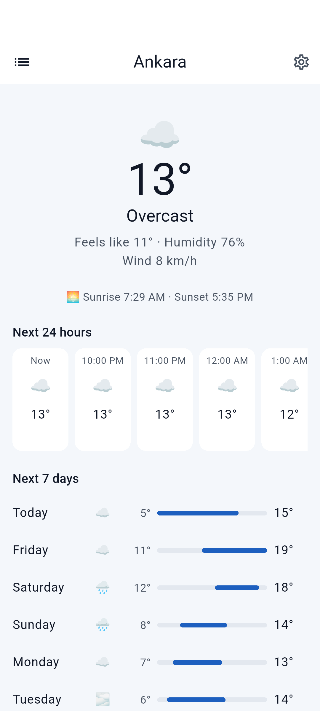
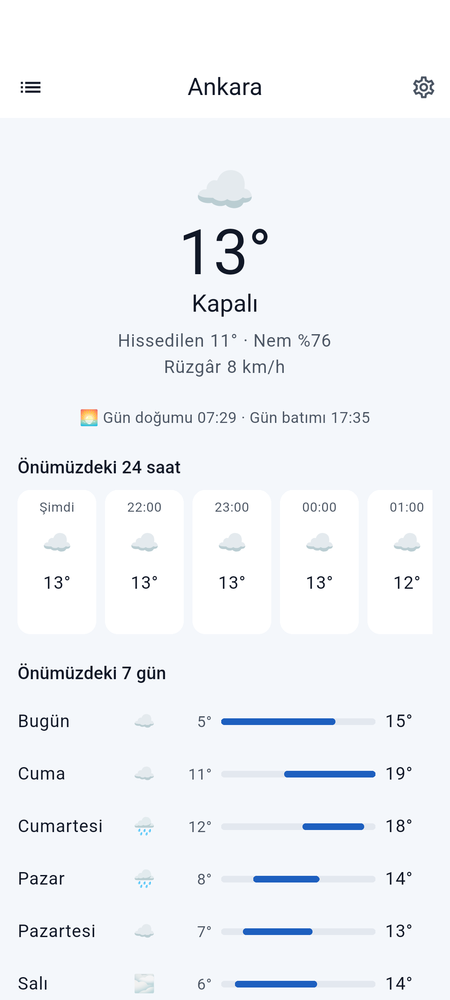
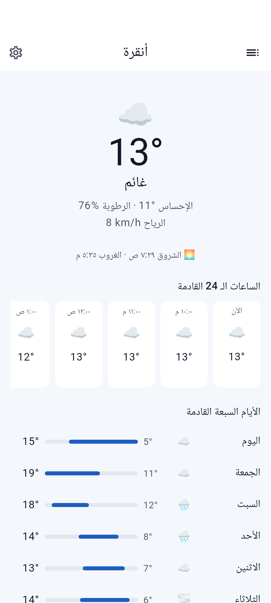
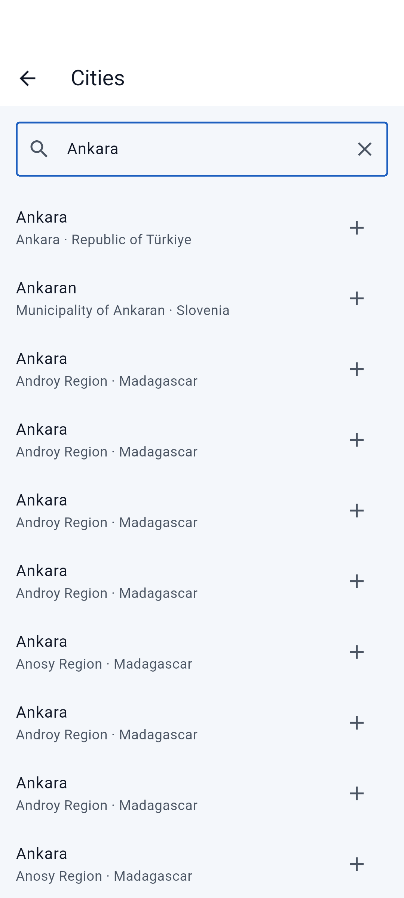
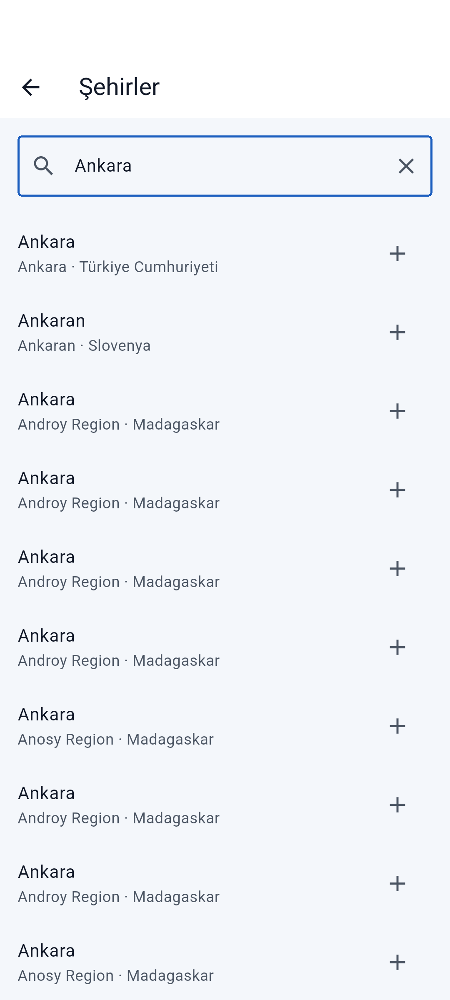
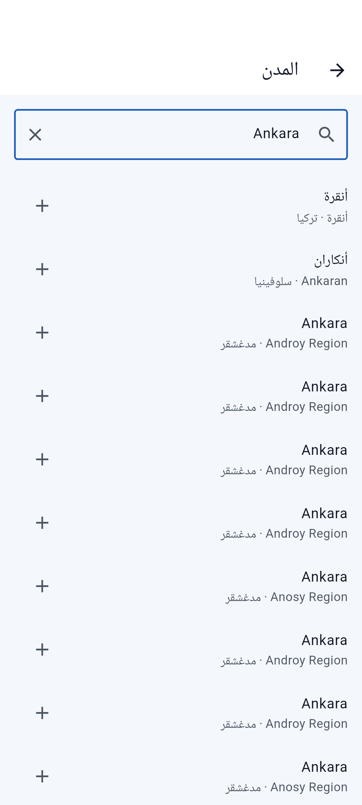
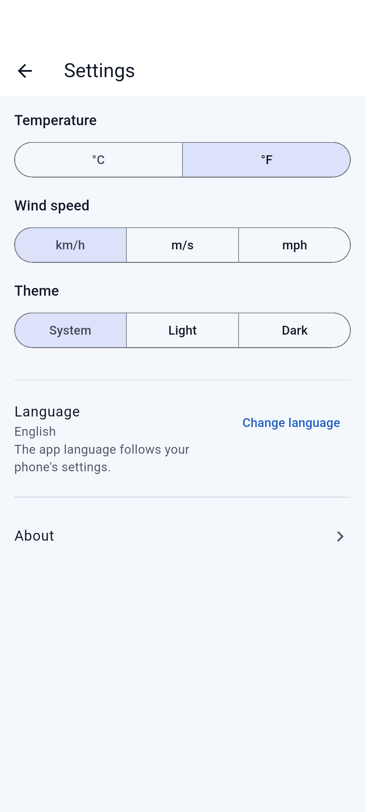
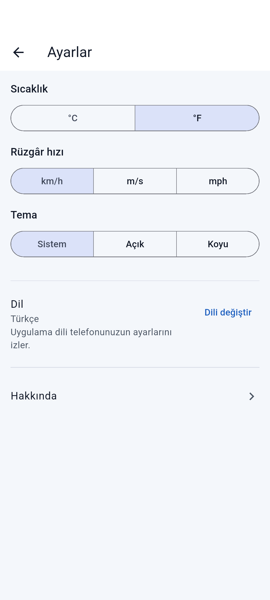
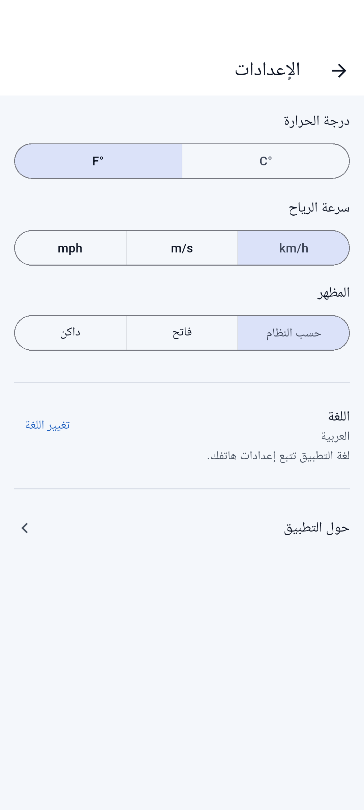

# Atmos — Flutter

**A weather app for Android and iOS from one Dart codebase, built step by step as a public
tutorial on professional Flutter development with Clean Architecture and an AI coding agent.**

<!-- step-banner:start -->
> ### 📍 You are on `main`: the newest version
> This branch has every step merged so far (see [PROGRESS.md](docs/PROGRESS.md)); at
> step 07 it becomes the finished app. To **learn how it is built**, start at
> [**Step 01 — Planning: documents before code**](https://github.com/AhmedJAbuSada/atmos-flutter/tree/step-01-planning) and follow the steps in order:
> each step branch has its own README that explains what that step is, why it exists,
> and what changed. All steps: [ROADMAP.md](docs/ROADMAP.md).
<!-- step-banner:end -->


-blue)


> ✅ **v1.0.0:** all seven steps are done. 348 tests in the Dart VM and Flutter's test engine,
> plus the main journey on an Android emulator in English, Turkish and Arabic on every push.

## Screenshots
The app on an Android emulator (Pixel 7 profile, API 35), against the real API, recorded by CI
([step 07](docs/steps/07-quality-release.md)).

| English | Türkçe | العربية (right to left) |
|---|---|---|
|  |  |  |
|  |  |  |
|  |  |  |

## Run it
Flutter **3.50.0** (stable), with the Android SDK and/or Xcode, as in the
[Flutter install guide](https://docs.flutter.dev/get-started/install).
```bash
flutter pub get                  # the whole workspace
tool/test_all.sh                 # every package's tests, with the coverage gates
flutter run                      # on an emulator, a simulator or a phone
```
No API key is needed. To see Arabic or Turkish, change the app's language in the phone's
settings (Android 13+: *Settings → Apps → Atmos → Language*; iOS: *Settings → Atmos → Language*).

## How it is built
```
packages/domain        pure Dart: entities, use cases, Result errors (no Flutter, no packages)
packages/data          package:http + DTOs, mappers, shared_preferences, geolocator → domain interfaces
packages/presentation  views of sealed states, Riverpod view models, gen-l10n, theme
lib/                   the app: composition root (ProviderScope overrides), typed routes, main.dart
tool/source_rules      the project's own checks: layer imports, Turkish casing, start/end
```
One pub workspace; `depend_on_referenced_packages` as an error and the source rules enforce the
arrows ([ADR-0001](docs/architecture/adr/0001-clean-architecture-with-a-pub-workspace.md)).
Full picture: [ARCHITECTURE.md](docs/architecture/ARCHITECTURE.md) and the
[18 ADRs](docs/architecture/adr/).

## The same app on four platforms

| Platform | Repository | Status |
|---|---|---|
| Android (Kotlin, Compose) | [atmos-android](https://github.com/AhmedJAbuSada/atmos-android) | ✅ v1.0.0 |
| iOS (Swift, SwiftUI) | [atmos-ios](https://github.com/AhmedJAbuSada/atmos-ios) | ✅ v1.0.0 |
| React Native (TypeScript) | [atmos-react-native](https://github.com/AhmedJAbuSada/atmos-react-native) | ✅ v1.0.0 |
| **Flutter** (Dart) | you are here | ✅ v1.0.0 |

## The seven steps

| Step | Branch | What you learn |
|---|---|---|
| 01 | [`step-01-planning`](../../tree/step-01-planning) | Shared product docs, Flutter architecture, ADRs, AI agent rules |
| 02 | [`step-02-project-structure`](../../tree/step-02-project-structure) | Flutter project, pub workspace, strict analysis, custom source rules, CI |
| 03 | [`step-03-domain-layer`](../../tree/step-03-domain-layer) | Entities, use cases, sealed `Result` errors |
| 04 | [`step-04-data-layer`](../../tree/step-04-data-layer) | `package:http` + DTOs, mappers, shared_preferences, geolocator |
| 05 | [`step-05-presentation-ui`](../../tree/step-05-presentation-ui) | Screens as stateless views, theme, gen-l10n, RTL |
| 06 | [`step-06-integration`](../../tree/step-06-integration) | Riverpod view models, navigation, permissions |
| 07 | [`step-07-quality-release`](../../tree/step-07-quality-release) | `integration_test` end to end, screenshots, release |

Full details: [ROADMAP.md](docs/ROADMAP.md).

## Features (v1.0)
Current weather at your location · 24 hours and 7 days · city search with names in your
language · saved cities · offline with the last data · °C/°F and wind units · dark mode ·
**English, Türkçe, العربية** (right to left). Weather data by
[Open-Meteo.com](https://open-meteo.com/); no API key needed.

> **Note on translations:** the Turkish and Arabic texts are written with an AI agent and have
> not yet been reviewed by a native speaker.

## 🤖 Built with an AI agent
[AI_WORKFLOW.md](docs/AI_WORKFLOW.md) · [AGENTS.md](AGENTS.md) ·
[docs/ai/prompts/](docs/ai/prompts/) · every step guide ends with *how the AI agent helped*.

## Author
**Ahmed J. AbuSada**, senior mobile and front-end developer ·
[@AhmedJAbuSada](https://github.com/AhmedJAbuSada)

## License
[MIT](LICENSE). Weather data © Open-Meteo.com, [CC BY 4.0](https://creativecommons.org/licenses/by/4.0/).
