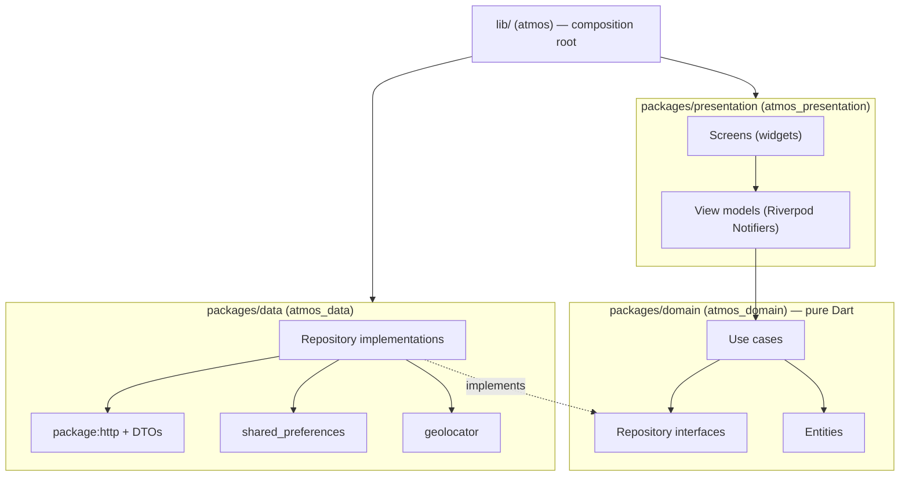
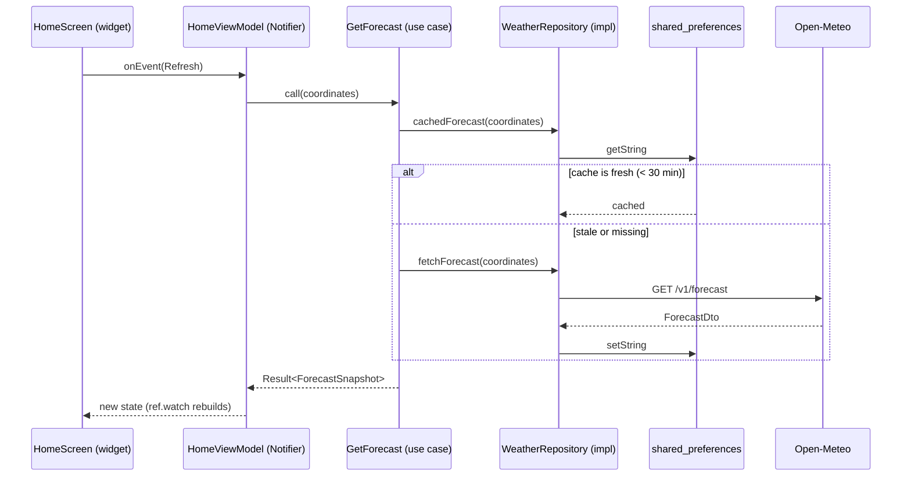

# Architecture

Atmos for Flutter follows **Clean Architecture** with three layers, the same as the
[Android](https://github.com/AhmedJAbuSada/atmos-android/blob/main/docs/architecture/ARCHITECTURE.md),
[iOS](https://github.com/AhmedJAbuSada/atmos-ios/blob/main/docs/architecture/ARCHITECTURE.md)
and [React Native](https://github.com/AhmedJAbuSada/atmos-react-native/blob/main/docs/architecture/ARCHITECTURE.md)
versions. One Dart codebase serves Android and iOS. The *reasons* for each choice are in the
[ADRs](adr/).

## 1. The one rule: dependencies point inwards



- `atmos_presentation` depends on `atmos_domain`.
- `atmos_data` depends on `atmos_domain`.
- `atmos_domain` depends on **nothing**: no `package:flutter`, no `dart:ui`, no `dart:io`, no
  http, no storage package. Only the core Dart libraries (`dart:core`, `dart:async`,
  `dart:collection`, `dart:convert`, `dart:math`, `dart:typed_data`).
- Only the app (`lib/`, the package `atmos`) depends on everything, to build the object graph
  (ADR-0004).

> **Why?** The business rules change least and matter most. With no framework imports they
> run with `dart test` on the plain Dart VM, in milliseconds, without a Flutter engine. The
> network, the storage, or even the UI toolkit can change without touching a single rule.

## 2. How the rule is enforced

Dart has real packages, so each layer is a **package in a pub workspace** (ADR-0001). A
package can only use what its `pubspec.yaml` declares, and `atmos_domain` declares no
dependencies at all.

A workspace has one shared resolution, so on its own it does **not** stop a stray import: the
analyzer resolves `package:flutter` and `dart:ui` inside the domain because another package of
the workspace uses them. Two tools close that gap:

| Guard | Catches | How it fails CI |
|---|---|---|
| Lint `depend_on_referenced_packages`, raised to **error** | Importing a package that the importing package's `pubspec.yaml` does not declare (`package:flutter` in the domain, `package:atmos_data` in presentation) | `dart analyze` error |
| Custom check `tool/source_rules` (layer imports) | What a pubspec cannot express: `dart:ui` or `dart:io` in the domain, Flutter widgets in data, data packages in presentation | Non-zero exit in CI |

| Layer (package) | May import | Must not import |
|---|---|---|
| `atmos_domain` | core Dart libraries, itself | `package:flutter`, `dart:ui`, `dart:io`, any other package |
| `atmos_data` | `atmos_domain`, http, storage, location, `package:flutter/services.dart` and `foundation.dart` | `atmos_presentation`, `atmos`, widgets, Riverpod |
| `atmos_presentation` | `atmos_domain`, Flutter, Riverpod, `intl` | `atmos_data`, `atmos`, http, storage, location, `dart:io` |
| `atmos` (the app) | everything | — |

```
atmos-flutter/
├── pubspec.yaml          → the app (package atmos) and the workspace root
├── lib/                  → composition root, MaterialApp, navigation (ADR-0004, ADR-0010)
├── android/, ios/        → the native host projects
├── packages/
│   ├── domain/           → entities, repository interfaces, use cases, Result
│   ├── data/             → DTOs, http client, mappers, shared_preferences, geolocator
│   └── presentation/     → screens, Riverpod view models, theme, formatting, l10n
└── tool/source_rules/    → the custom checks (layers, casing, start/end)
```

## 3. Folders by feature inside each package

```
packages/domain/lib/src/
├── weather/    forecast.dart, weather_condition.dart, get_forecast.dart …
├── location/   coordinates.dart, city.dart, city_use_cases.dart …
├── settings/   units.dart, user_settings.dart …
└── common/     result.dart, domain_error.dart, date_provider.dart
```

Each package exposes one library (`package:atmos_domain/atmos_domain.dart`) that exports its
public API; everything under `lib/src/` is private by convention.

## 4. Data flow (one request)



## 5. Rules per layer

### Domain
- Pure Dart; strict analyzer modes (`strict-casts`, `strict-inference`, `strict-raw-types`).
- **Entities** are immutable `final class`es with `final` fields and domain names
  (`temperature`, not `temperature_2m`).
- **Use cases** are small classes with a `call` method, named after what they do
  (`GetForecast`, `SearchCities`), so `getForecast(coordinates)` reads like a function.
- **Repository interfaces** are `abstract interface class`es that speak in entities, never
  DTOs.
- Errors are values: fallible functions return `Future<Result<T>>`, a sealed class holding a
  value or a sealed `DomainError` (ADR-0006). No exception crosses a layer boundary.
- Time comes from an injected `DateProvider`, never `DateTime.now()` in logic.

### Data
- **DTOs** mirror the JSON; every field is nullable. Parsing is hand-written with
  `dart:convert` and pattern matching, no code generation (ADR-0007).
- **Mappers** are pure functions, tested against [`docs/api/samples`](../api/samples/).
- Repositories turn every network, HTTP and parsing failure into a `DomainError`.
- Plugins (`shared_preferences`, `geolocator`) sit behind small interfaces, so tests use
  in-memory fakes and no platform channel.

### Presentation
- **Unidirectional data flow:** a screen reads one state object from its view model and sends
  it events. Screens hold no business logic.
- **View models are Riverpod `Notifier`s**, one per screen, each with one sealed state class
  (ADR-0003). They are tested with a `ProviderContainer` and fakes, without widgets.
- Each screen is split into a **container** (a `ConsumerWidget` that watches the view model)
  and a **view** (a `StatelessWidget` that takes `state` and `onEvent`), so every state can be
  rendered in a widget test without a view model.
- All user-facing text comes from ARB files in en, tr and ar through `gen-l10n` (ADR-0005).
- Layouts use `start`/`end` (`EdgeInsetsDirectional`, `AlignmentDirectional`,
  `TextAlign.start`), never `left`/`right`; a custom check enforces it (ADR-0012).

## 6. Cross-cutting concerns

| Concern | Where | How |
|---|---|---|
| Dependency injection | `lib/` | Riverpod providers; the app's `ProviderScope` overrides them with the real implementations (ADR-0004) |
| Navigation | `lib/` + screens | The SDK's `Navigator` with typed route functions (ADR-0010) |
| Localization | `packages/presentation` | `gen-l10n` + ARB, `intl` for numbers and dates, directional isolates, language from the OS (ADR-0005) |
| Settings | `atmos_data` (shared_preferences) → domain | Observed as a `Stream` from a small value store |
| Static analysis | everywhere | Strict analyzer, `flutter_lints` plus extra rules, `tool/source_rules` (ADR-0012) |

## 7. Testing strategy

| Layer | Test type | Tools | Target |
|---|---|---|---|
| Domain | Unit | `package:test`, hand-written fakes | ≥ 90% |
| Data | Unit + integration | `flutter_test`, `MockClient` from `package:http/testing.dart` replaying the recorded samples, an in-memory store | ≥ 80% |
| Presentation | View models; widgets | `flutter_test`, `ProviderContainer` with overrides | Every view model; every screen state |
| App | End to end | `integration_test` on an Android emulator in CI, real API | The main journey |
